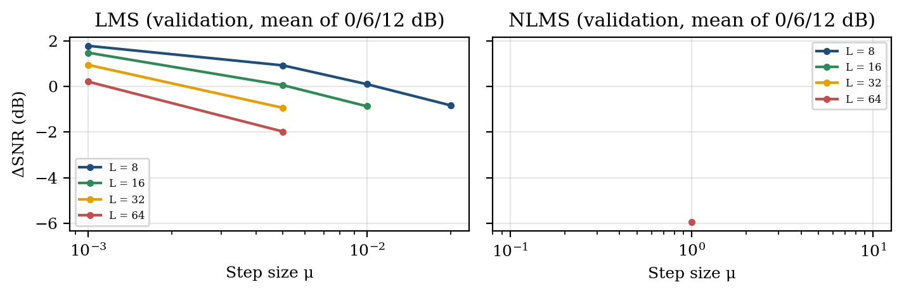
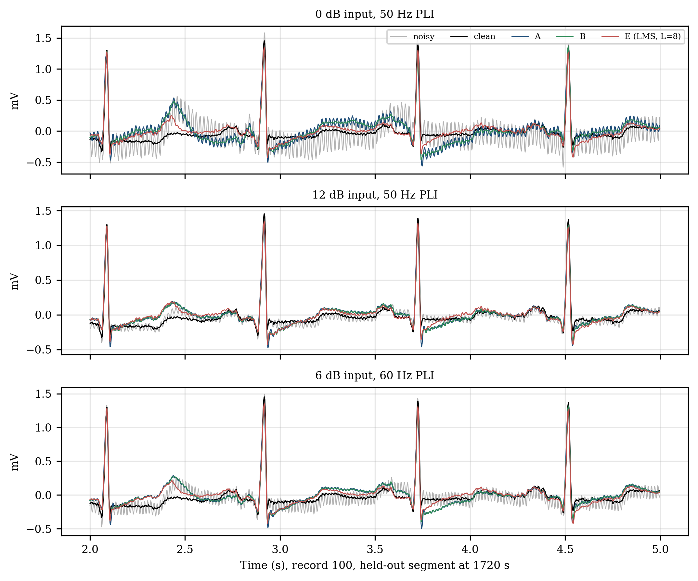
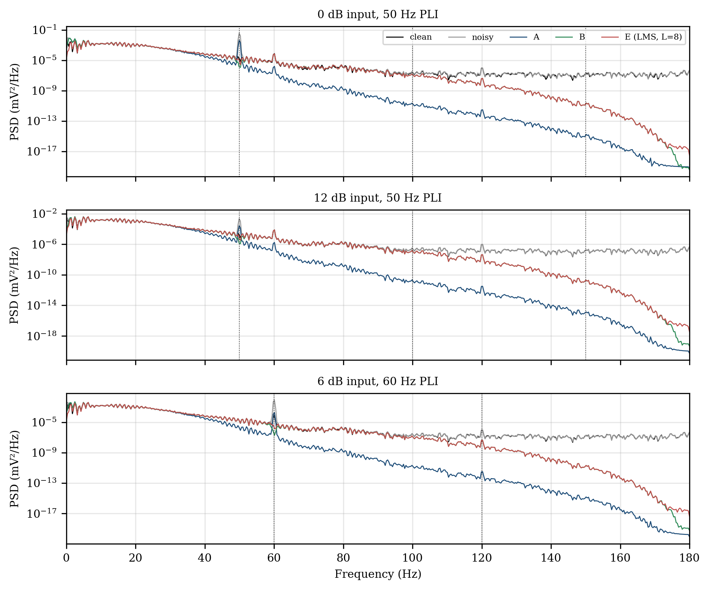

# Appendix B – Supplementary Results / Dataset Details

All values below are outputs of the code in this repository (`run_draft.py`, `report_values.py`), run on
MIT-BIH record 100 and the NSTDB `em` record. Figure and table numbers continue those of the report.

## B.1 Dataset log

* **Record:** MIT-BIH Arrhythmia Database record 100, channel 0 (MLII), 360 Hz, 11-bit.
* **Validation:** segments starting at samples 0, 3 600, …, 212 400 (0–590 s); 60 segments of 3 600 samples; 760 annotated beats.
* **Held-out test:** segments starting at samples 324 000, 327 600, …, 644 400 (900–1790 s); 90 segments; 1 124 annotated beats.
* The 600–900 s interval is unused, so validation and test never overlap. No segment contained a signal-quality or
  noise annotation (`~ | Q ! x`), so none was excluded.
* **Seed of each mixture:** `numpy.random.default_rng([2026, record, start_sample, round(10·SNR_dB), f0])` –
  every method receives the identical noisy realisation.
* **Transient exclusion and alignment:** the first 360 samples (1 s) of every output are excluded; each output is
  aligned to the clean ECG with the integer delay (0–40 samples) that maximises their cross-correlation.

## B.2 Noise settings

* PLI-to-motion power ratio 0 dB (g_m = g_p = 0.7071 in eq. (1)); one common gain then sets the exact input SNR (eq. (3)).
  The recomputed SNR_in matches the target to within 3.6e-15 dB.
* **PLI:** unit-RMS sinusoid √2·sin(2πf₀n/Fs + φ), φ uniform in [0, 2π) for each mixture; f₀ = 50 or 60 Hz; no harmonics
  or amplitude modulation (T2 also uses f₀ + 0.2 Hz).
* **em:** NSTDB record `em`, channel 0; the excerpt starts at the same sample index as the ECG segment, its mean is
  removed and it is scaled to unit RMS; the same unit-RMS excerpt is the motion reference, passed through the same
  0.5–100 Hz band-pass as the primary input.

## B.3 Locked parameters and full parameter sweep

**Table V (repeated). Locked parameters selected on validation segments** (50 Hz, ΔSNR averaged over 0/6/12 dB)

| Algorithm | L | Selected μ | Validation ΔSNR (dB) | Rejected μ |
|---|---|---|---|---|
| LMS | 8 | 0.001 | 1.78 | 0.05 |
| LMS | 16 | 0.001 | 1.48 | 0.02, 0.05 |
| LMS | 32 | 0.001 | 0.94 | 0.01, 0.02, 0.05 |
| LMS | 64 | 0.001 | 0.21 | 0.01, 0.02, 0.05 |
| NLMS | 8 | none stable | – | 0.05, 0.1, 0.25, 0.5, 1.0 |
| NLMS | 16 | none stable | – | 0.05, 0.1, 0.25, 0.5, 1.0 |
| NLMS | 32 | none stable | – | 0.05, 0.1, 0.25, 0.5, 1.0 |
| NLMS | 64 | 1.0 | -5.94 | 0.05, 0.1, 0.25, 0.5 |
| PLI branch (LMS) | 2 weights | 0.005 | 0.36 | none |
| PLI branch (NLMS) | 2 weights | 0.05 | 0.23 | 1.0 |

**Table XII. Full validation sweep** (50 settings, including rejected ones)

| Branch | Algorithm | L | μ | Stable (rule) | Validation ΔSNR (dB) | Selected |
|---|---|---|---|---|---|---|
| PLI (C) | LMS | 2 | 0.001 | yes | 0.14 |  |
| PLI (C) | LMS | 2 | 0.005 | yes | 0.36 | ✓ |
| PLI (C) | LMS | 2 | 0.01 | yes | 0.33 |  |
| PLI (C) | LMS | 2 | 0.02 | yes | 0.26 |  |
| PLI (C) | LMS | 2 | 0.05 | yes | 0.02 |  |
| PLI (C) | NLMS | 2 | 0.05 | yes | 0.23 | ✓ |
| PLI (C) | NLMS | 2 | 0.1 | yes | 0.02 |  |
| PLI (C) | NLMS | 2 | 0.25 | yes | -0.88 |  |
| PLI (C) | NLMS | 2 | 0.5 | yes | -2.25 |  |
| PLI (C) | NLMS | 2 | 1.0 | no | -6.13 |  |
| Motion (E) | LMS | 8 | 0.001 | yes | 1.78 | ✓ |
| Motion (E) | LMS | 8 | 0.005 | yes | 0.92 |  |
| Motion (E) | LMS | 8 | 0.01 | yes | 0.10 |  |
| Motion (E) | LMS | 8 | 0.02 | yes | -0.83 |  |
| Motion (E) | LMS | 8 | 0.05 | no | – |  |
| Motion (E) | LMS | 16 | 0.001 | yes | 1.48 | ✓ |
| Motion (E) | LMS | 16 | 0.005 | yes | 0.05 |  |
| Motion (E) | LMS | 16 | 0.01 | yes | -0.87 |  |
| Motion (E) | LMS | 16 | 0.02 | no | – |  |
| Motion (E) | LMS | 16 | 0.05 | no | – |  |
| Motion (E) | LMS | 32 | 0.001 | yes | 0.94 | ✓ |
| Motion (E) | LMS | 32 | 0.005 | yes | -0.94 |  |
| Motion (E) | LMS | 32 | 0.01 | no | – |  |
| Motion (E) | LMS | 32 | 0.02 | no | – |  |
| Motion (E) | LMS | 32 | 0.05 | no | – |  |
| Motion (E) | LMS | 64 | 0.001 | yes | 0.21 | ✓ |
| Motion (E) | LMS | 64 | 0.005 | yes | -1.98 |  |
| Motion (E) | LMS | 64 | 0.01 | no | – |  |
| Motion (E) | LMS | 64 | 0.02 | no | – |  |
| Motion (E) | LMS | 64 | 0.05 | no | – |  |
| Motion (E) | NLMS | 8 | 0.05 | no | – |  |
| Motion (E) | NLMS | 8 | 0.1 | no | – |  |
| Motion (E) | NLMS | 8 | 0.25 | no | – |  |
| Motion (E) | NLMS | 8 | 0.5 | no | – |  |
| Motion (E) | NLMS | 8 | 1.0 | no | – |  |
| Motion (E) | NLMS | 16 | 0.05 | no | – |  |
| Motion (E) | NLMS | 16 | 0.1 | no | – |  |
| Motion (E) | NLMS | 16 | 0.25 | no | – |  |
| Motion (E) | NLMS | 16 | 0.5 | no | – |  |
| Motion (E) | NLMS | 16 | 1.0 | no | – |  |
| Motion (E) | NLMS | 32 | 0.05 | no | – |  |
| Motion (E) | NLMS | 32 | 0.1 | no | – |  |
| Motion (E) | NLMS | 32 | 0.25 | no | – |  |
| Motion (E) | NLMS | 32 | 0.5 | no | – |  |
| Motion (E) | NLMS | 32 | 1.0 | no | – |  |
| Motion (E) | NLMS | 64 | 0.05 | no | – |  |
| Motion (E) | NLMS | 64 | 0.1 | no | – |  |
| Motion (E) | NLMS | 64 | 0.25 | no | – |  |
| Motion (E) | NLMS | 64 | 0.5 | no | – |  |
| Motion (E) | NLMS | 64 | 1.0 | yes | -5.94 | ✓ |

*Fig. 12. Validation sweep: ΔSNR versus step size for each filter length (LMS left, NLMS right; rejected settings are not plotted).*

## B.4 Filter specifications

All fixed filters are causal second-order sections (SOS) designed with SciPy (`butter`, `iirnotch`) at Fs = 360 Hz.
**Table XIII. SOS coefficients** (each row is one section):

**Baseline A: Butterworth band-pass 0.5-40 Hz, 4th-order prototype (8th-order band-pass)**

| Section | b0 | b1 | b2 | a0 | a1 | a2 |
|---|---|---|---|---|---|---|
| 1 | +6.6048756713e-03 | +1.3209751343e-02 | +6.6048756713e-03 | +1.0000000000e+00 | -9.7894906924e-01 | +2.6401065276e-01 |
| 2 | +1.0000000000e+00 | +2.0000000000e+00 | +1.0000000000e+00 | +1.0000000000e+00 | -1.2374771035e+00 | +6.1247881993e-01 |
| 3 | +1.0000000000e+00 | -2.0000000000e+00 | +1.0000000000e+00 | +1.0000000000e+00 | -1.9836536735e+00 | +9.8373240690e-01 |
| 4 | +1.0000000000e+00 | -2.0000000000e+00 | +1.0000000000e+00 | +1.0000000000e+00 | -1.9933805831e+00 | +9.9345700282e-01 |

**Baseline B / adaptive front end: Butterworth band-pass 0.5-100 Hz, 4th-order prototype**

| Section | b0 | b1 | b2 | a0 | a1 | a2 |
|---|---|---|---|---|---|---|
| 1 | +1.2889853689e-01 | +2.5779707379e-01 | +1.2889853689e-01 | +1.0000000000e+00 | +1.7546645815e-01 | +4.7217141609e-02 |
| 2 | +1.0000000000e+00 | +2.0000000000e+00 | +1.0000000000e+00 | +1.0000000000e+00 | +2.5115959426e-01 | +4.5498702988e-01 |
| 3 | +1.0000000000e+00 | -2.0000000000e+00 | +1.0000000000e+00 | +1.0000000000e+00 | -1.9838454806e+00 | +9.8392197641e-01 |
| 4 | +1.0000000000e+00 | -2.0000000000e+00 | +1.0000000000e+00 | +1.0000000000e+00 | -1.9933016441e+00 | +9.9337770695e-01 |

**IIR notch f0 = 50 Hz, Q = 20 (scipy.signal.iirnotch)**

| Section | b0 | b1 | b2 | a0 | a1 | a2 |
|---|---|---|---|---|---|---|
| 1 | +9.7864587113e-01 | -1.2581228805e+00 | +9.7864587113e-01 | +1.0000000000e+00 | -1.2581228805e+00 | +9.5729174225e-01 |

**IIR notch f0 = 50 Hz, Q = 30 (scipy.signal.iirnotch)**

| Section | b0 | b1 | b2 | a0 | a1 | a2 |
|---|---|---|---|---|---|---|
| 1 | +9.8566310036e-01 | -1.2671440565e+00 | +9.8566310036e-01 | +1.0000000000e+00 | -1.2671440565e+00 | +9.7132620073e-01 |

**IIR notch f0 = 50 Hz, Q = 40 (scipy.signal.iirnotch)**

| Section | b0 | b1 | b2 | a0 | a1 | a2 |
|---|---|---|---|---|---|---|
| 1 | +9.8920897597e-01 | -1.2717025463e+00 | +9.8920897597e-01 | +1.0000000000e+00 | -1.2717025463e+00 | +9.7841795194e-01 |

**IIR notch f0 = 60 Hz, Q = 20 (scipy.signal.iirnotch)**

| Section | b0 | b1 | b2 | a0 | a1 | a2 |
|---|---|---|---|---|---|---|
| 1 | +9.7448228336e-01 | -9.7448228336e-01 | +9.7448228336e-01 | +1.0000000000e+00 | -9.7448228336e-01 | +9.4896456671e-01 |

**IIR notch f0 = 60 Hz, Q = 30 (scipy.signal.iirnotch)**

| Section | b0 | b1 | b2 | a0 | a1 | a2 |
|---|---|---|---|---|---|---|
| 1 | +9.8284438740e-01 | -9.8284438740e-01 | +9.8284438740e-01 | +1.0000000000e+00 | -9.8284438740e-01 | +9.6568877481e-01 |

**IIR notch f0 = 60 Hz, Q = 40 (scipy.signal.iirnotch)**

| Section | b0 | b1 | b2 | a0 | a1 | a2 |
|---|---|---|---|---|---|---|
| 1 | +9.8707843546e-01 | -9.8707843546e-01 | +9.8707843546e-01 | +1.0000000000e+00 | -9.8707843546e-01 | +9.7415687092e-01 |

Measured responses: notch null at 50.00 Hz with −3 dB width 1.67 Hz
(50 Hz, Q = 30) and 60.00 Hz / 2.00 Hz (60 Hz); band-pass A −3 dB at
0.501 and 40.00 Hz; band-pass B −3 dB at
0.501 and 100.00 Hz.

## B.5 Additional results

**Held-out results at 6 dB, 50 Hz, all locked configurations** (mean ± s.d. over 90 segments)

| Method | ΔSNR (dB) | RMSE (mV) | r | R-peak timing err (ms) | QRS amp. err (%) | PLI atten. (dB) |
|---|---|---|---|---|---|---|
| Noisy input | 0.00 ± 0.00 | 0.1006 ± 0.0061 | 0.893 ± 0.007 | 1.04 ± 0.42 | 6.1 ± 1.2 | 0.0 ± 0.0 |
| A | -0.16 ± 0.87 | 0.1034 ± 0.0169 | 0.867 ± 0.035 | 1.53 ± 0.46 | 2.7 ± 0.6 | 9.3 ± 0.0 |
| B | 0.57 ± 1.02 | 0.0954 ± 0.0176 | 0.887 ± 0.035 | 0.39 ± 0.30 | 1.9 ± 0.4 | 38.4 ± 1.4 |
| C – LMS | 0.55 ± 1.03 | 0.0956 ± 0.0177 | 0.887 ± 0.035 | 0.45 ± 0.33 | 1.9 ± 0.4 | 31.4 ± 1.4 |
| C – NLMS | 0.43 ± 1.02 | 0.0969 ± 0.0178 | 0.886 ± 0.035 | 0.35 ± 0.30 | 2.7 ± 0.7 | 42.6 ± 1.3 |
| D – LMS, L = 8 | -0.78 ± 0.56 | 0.1106 ± 0.0125 | 0.852 ± 0.028 | 1.28 ± 0.50 | 4.6 ± 1.0 | -0.0 ± 0.0 |
| E – LMS, L = 8 | 1.59 ± 0.92 | 0.0846 ± 0.0132 | 0.908 ± 0.026 | 0.56 ± 0.36 | 2.2 ± 0.6 | 31.5 ± 1.4 |
| E – LMS, L = 16 | 1.20 ± 0.91 | 0.0884 ± 0.0137 | 0.899 ± 0.028 | 0.71 ± 0.40 | 2.7 ± 0.8 | 31.4 ± 1.4 |
| E – LMS, L = 32 | 0.63 ± 0.95 | 0.0945 ± 0.0150 | 0.883 ± 0.033 | 0.94 ± 0.58 | 3.4 ± 0.9 | 31.4 ± 1.4 |
| E – LMS, L = 64 | -0.16 ± 0.96 | 0.1034 ± 0.0164 | 0.858 ± 0.038 | 1.45 ± 0.87 | 4.4 ± 1.2 | 31.4 ± 1.4 |
| E – NLMS, L = 64 | -6.08 ± 0.80 | 0.2035 ± 0.0248 | 0.243 ± 0.065 | 12.57 ± 1.28 | 56.5 ± 3.1 | 39.6 ± 2.5 |

**ΔSNR (dB) across all conditions** (held-out means)

| Method | 0 dB, 50 Hz | 0 dB, 60 Hz | 6 dB, 50 Hz | 6 dB, 60 Hz | 12 dB, 50 Hz | 12 dB, 60 Hz |
|---|---|---|---|---|---|---|
| A | 3.01 | 3.46 | -0.16 | 0.04 | -4.99 | -4.92 |
| B | 3.84 | 3.84 | 0.57 | 0.56 | -4.29 | -4.30 |
| C – LMS | 3.81 | 3.80 | 0.55 | 0.54 | -4.30 | -4.32 |
| D – LMS, L = 8 | 1.63 | 1.65 | -0.78 | -0.78 | -5.08 | -5.08 |
| E – LMS, L = 8 | 7.36 | 7.34 | 1.59 | 1.57 | -4.35 | -4.37 |
| E – NLMS, L = 64 | -0.15 | -0.11 | -6.08 | -6.08 | -12.05 | -12.06 |

*Fig. 13. Time-domain comparison on the same held-out segment at 0 dB/50 Hz, 12 dB/50 Hz and 6 dB/60 Hz (E: LMS, L = 8).*

*Fig. 14. Power spectral density for the same three conditions.*

**Table XIV. T1 – motion artifact only (no PLI), Baseline A, held-out**

| Input SNR | ΔSNR (dB) | RMSE (mV) | r |
|---|---|---|---|
| 0 dB | 1.62 ± 1.61 | 0.1701 ± 0.0358 | 0.722 ± 0.073 |
| 6 dB | -0.93 ± 1.06 | 0.1134 ± 0.0201 | 0.844 ± 0.042 |
| 12 dB | -5.27 ± 0.89 | 0.0934 ± 0.0156 | 0.889 ± 0.031 |

**Table XV. T2 – PLI only (no motion), Baseline B, 6 dB, held-out**

| f0 (Hz) | Offset (Hz) | Q | PLI atten. (dB) | ΔSNR (dB) | RMSE (mV) |
|---|---|---|---|---|---|
| 50 | 0.0 | 20 | 44.6 ± 1.3 | 2.18 ± 1.08 | 0.0792 |
| 50 | 0.0 | 30 | 41.5 ± 1.4 | 2.19 ± 1.08 | 0.0791 |
| 50 | 0.0 | 40 | 39.5 ± 1.4 | 2.20 ± 1.08 | 0.0790 |
| 50 | 0.2 | 20 | 16.0 ± 0.1 | 2.00 ± 1.04 | 0.0808 |
| 50 | 0.2 | 30 | 12.6 ± 0.1 | 1.81 ± 1.00 | 0.0825 |
| 50 | 0.2 | 40 | 10.3 ± 0.1 | 1.56 ± 0.96 | 0.0848 |
| 60 | 0.0 | 20 | 51.8 ± 1.8 | 2.18 ± 1.08 | 0.0791 |
| 60 | 0.0 | 30 | 48.6 ± 1.8 | 2.18 ± 1.08 | 0.0792 |
| 60 | 0.0 | 40 | 46.5 ± 1.8 | 2.18 ± 1.08 | 0.0792 |
| 60 | 0.2 | 20 | 17.6 ± 0.1 | 2.06 ± 1.05 | 0.0803 |
| 60 | 0.2 | 30 | 14.2 ± 0.1 | 1.91 ± 1.02 | 0.0816 |
| 60 | 0.2 | 40 | 11.8 ± 0.1 | 1.72 ± 0.98 | 0.0833 |

**T6 – reference stress** (motion-only mixtures, 6 dB; LMS L = 16, NLMS L = 64 – its only stable setting)

| Condition | LMS ΔSNR (dB) | NLMS ΔSNR (dB) |
|---|---|---|
| reference gain ×0.1 | -0.08 ± 1.00 | -6.00 ± 0.79 |
| reference gain ×0.316 | 1.24 ± 0.89 | -6.01 ± 0.80 |
| reference gain ×1.0 | 1.14 ± 0.91 | -6.01 ± 0.80 |
| reference gain ×3.16 | -1.21 ± 0.96 | -6.01 ± 0.80 |
| reference gain ×10.0 | unstable | -6.01 ± 0.80 |
| reference correlation ρ = 1.0 | 1.14 ± 0.91 | -6.01 ± 0.80 |
| reference correlation ρ = 0.9 | 1.08 ± 0.90 | -5.92 ± 0.45 |
| reference correlation ρ = 0.7 | 0.94 ± 0.87 | -6.07 ± 0.60 |
| reference correlation ρ = 0.5 | 0.66 ± 0.86 | -6.30 ± 0.43 |
| reference correlation ρ = 0.3 | 0.14 ± 0.91 | unstable |

**Diagnostic – front-end fidelity ceiling** (clean ECG alone passed through each causal front end; not one of the
compared methods): output SNR 7.49 dB for the 0.5–40 Hz band-pass (r = 0.906)
and 8.18 dB for the 0.5–100 Hz band-pass (r = 0.920).

**Diagnostic – NLMS regulariser sensitivity** (E, L = 16; not part of the protocol, which fixes ε = 10⁻⁶)

| ε | Rejected μ | Selected μ | Validation ΔSNR (dB) | Held-out ΔSNR, 6 dB 50 Hz | r |
|---|---|---|---|---|---|
| 1e-06 | 0.05, 0.1, 0.25, 0.5, 1.0 | None | – | – | – |
| 0.16 | none | 0.05 | -2.11 | -2.38 ± 0.89 | 0.782 |
| 1.6 | none | 0.05 | -0.47 | -0.78 ± 0.77 | 0.842 |

The optional baseline-wander (`bw`) test was not run.

## B.6 Timing log

Environment: Python 3.10.12, NumPy 2.2.6, SciPy 1.15.3, Matplotlib 3.10.9, WFDB 4.3.1; Linux virtual machine (Linux-6.8.0-149-generic-aarch64-with-glibc2.35) on an Apple-silicon MacBook Air (arm64). A batch of 4 held-out segments
(14 400 samples), 6 dB, 50 Hz; one warm-up run, then 5 timed runs; median and standard deviation of the time per
output sample. Runtimes are Python timings and depend on the computer; MAC counts are algorithmic estimates.

**Table XVI. Timing statistics (µs per output sample)**

| Method | L | Median | s.d. | MACs (LMS) | MACs (NLMS) |
|---|---|---|---|---|---|
| A | – | 0.019 | 0.000 | 20 | 20 |
| B | – | 0.046 | 0.000 | 25 | 25 |
| C | – | 2.558 | 0.006 | 25 | 26 |
| D | 8 | 2.859 | 0.016 | 57 | 59 |
| D | 16 | 2.928 | 0.009 | 73 | 75 |
| D | 32 | 2.917 | 0.015 | 105 | 107 |
| D | 64 | 3.025 | 0.013 | 169 | 171 |
| E | 8 | 5.099 | 0.002 | 62 | 65 |
| E | 16 | 5.430 | 0.746 | 78 | 81 |
| E | 32 | 5.232 | 0.022 | 110 | 113 |
| E | 64 | 5.354 | 0.146 | 174 | 177 |

Full run time of `run_draft.py`: 43 s.
